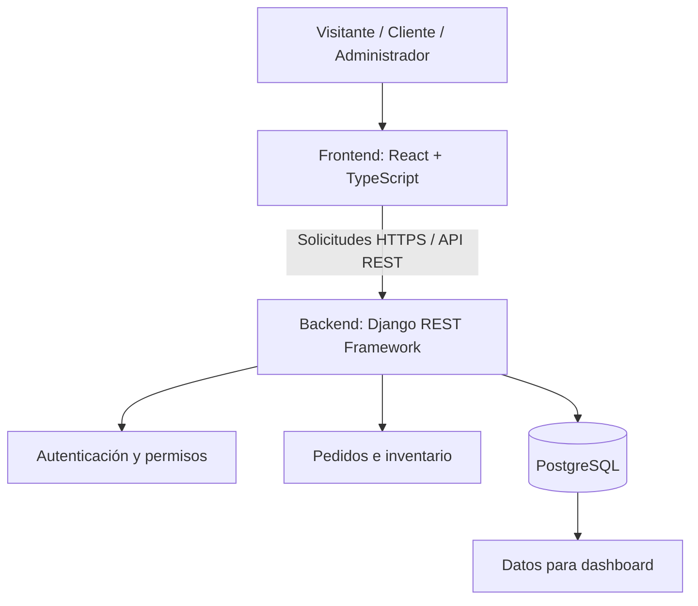
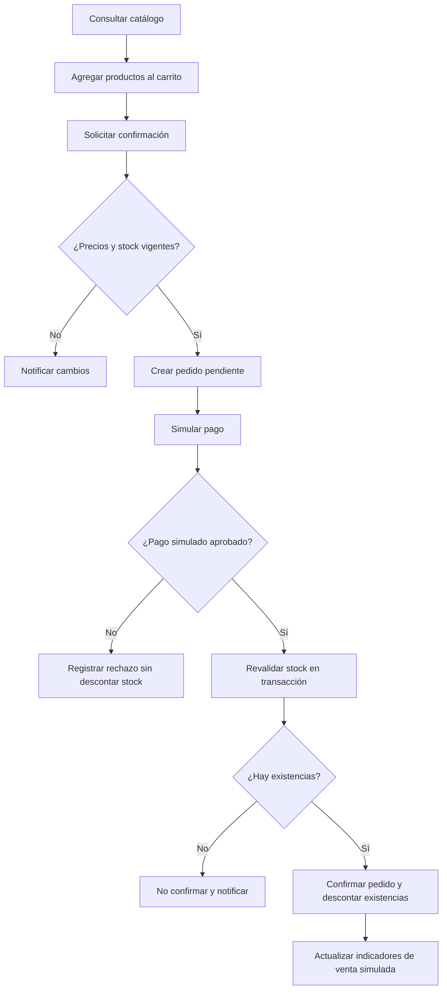
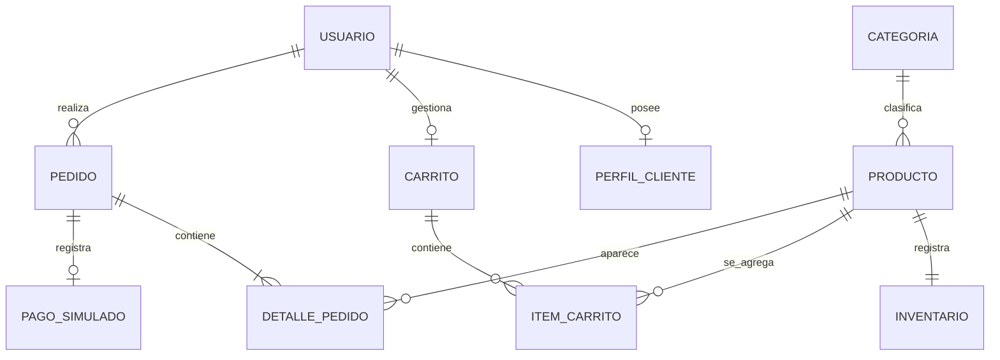
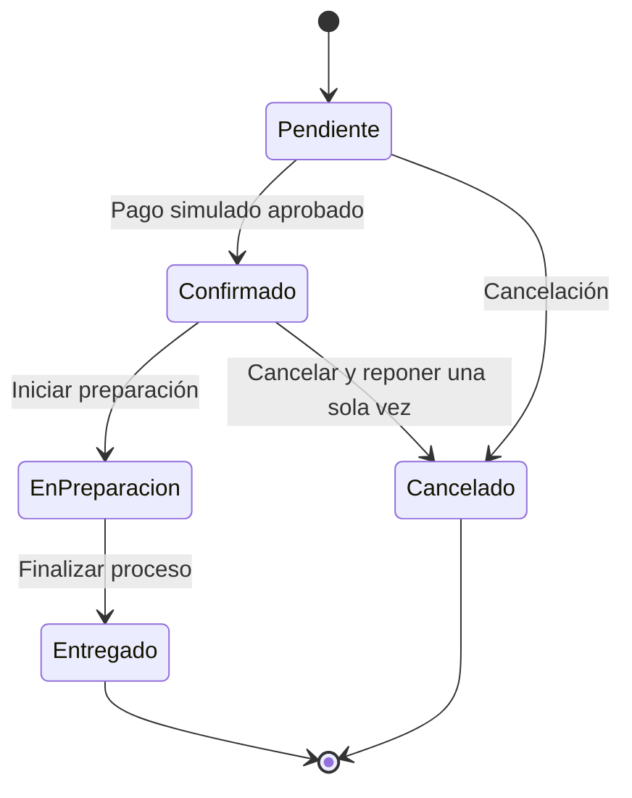

# Diagramas de diseño propuestos — SmartCommerce

Estos esquemas son **conceptuales** y se renderizan directamente en GitHub mediante Mermaid. No indican que exista código funcional.

## 1. Arquitectura general

## 2. Flujo de compra y stock

**Regla crítica:** pedido e inventario se actualizan de modo **atómico**. Un pago rechazado no reduce unidades; una cancelación confirmada repone una sola vez.

## 3. Modelo entidad–relación conceptual

## 4. Ciclo del pedido

**Nota:** el flujo mostrado es un modelo simplificado para esta etapa académica. Los estados definitivos se refinarán al diseñar el backend.